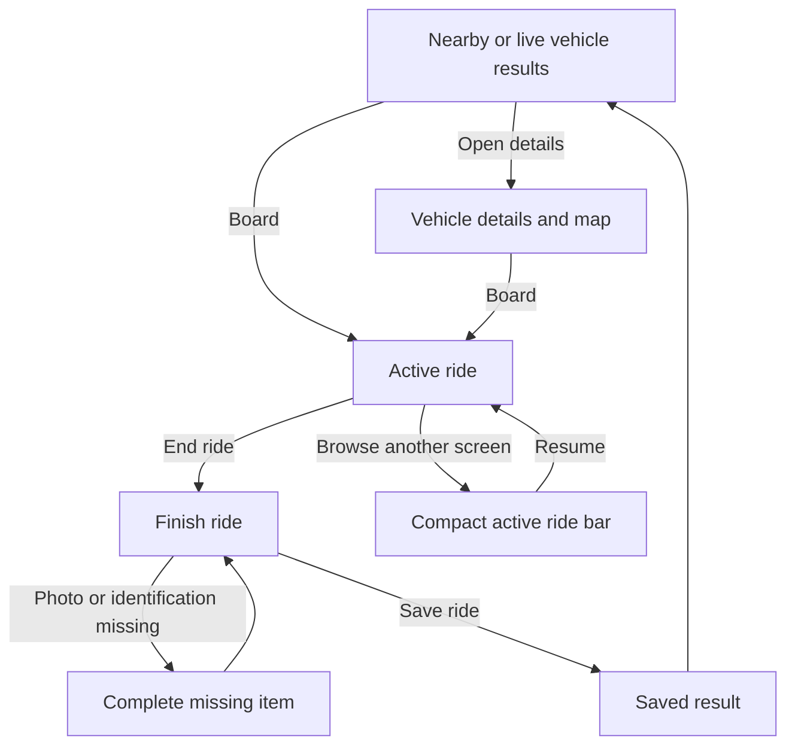

# Screen and ride-flow plan

Recorded 2026-11-16. Implemented following the owner's request to build with the additional suggestions; verification and release notes are linked below. The findings and proposed sequence below retain their planning context. This extends docs/verification/style-audit-2026-11-16/REVIEW.md and its retained captures/measurements. Owner direction and the recommendations below are intentionally separate. No recommendation in this document is marked approved by an agent.

## Owner direction

- Overhaul styling across the app, with compact information and less text.
- Put a line's current vehicles inside that line's details; show plates and reported locations.
- Expect connected use. Remove the standalone manual way of creating a new ride.
- Reduce the actions needed to log a vehicle and preserve continuity through the ride.
- Record findings and plan the screens before further implementation.

Online-first does not authorize losing an active ride when the connection drops. Preserve existing local timestamps, drafts, photos and ride history. Existing saves must survive the redesign.

## Findings from current code and rendered review

| Finding | Evidence | Effect |
|---|---|---|
| Two competing logging paths | index.html: Nearby/Log form switch, manual line/plate/time fields and Board now; js/nearby.js: nbSetMode/applyBoarding/startRide | Live selection still drops the rider into an editable form that repeats known data. |
| Map/details is a compulsory step before live boarding | js/nearby.js: nbRow opens nbOpen, which contains Board | Opening a map adds a step even when the vehicle is already identifiable. |
| Ending a ride returns to the long form | js/nearby.js: rideOff switches to form and suggests an alighting stop | The rider has to find the save action among stops, GPS, photos and notes. |
| Repeated explanations | index.html: “Stops travelled (filled in from the choices above, editable)”; renderRideBar repeats line, plate, boarding time, stop and completion prose | Reading competes with the immediate action. The information needs hierarchy and disclosure. |
| Advanced controls are in the main logging surface | index.html: Record my track, Add Garmin GPX, editable stop text, date/time and direction | Technical controls make an ordinary live ride look like a data-entry task. |
| Row density differs despite shared CSS classes | Audit measurements: fleet 144–165 px; Nearby 80–98 px | Component anatomy must be shared, not only badge colors. |
| Saving has real prerequisites | js/app.js form submit requires line, plate, time, ended recording and at least one photo | Removing the form must preserve validation and explain only the missing item. |
| Completion requirements and code disagree | docs/nearby-rides-decisions.md specifies bus duration + travel and metro rules; js/ride-core.js currently qualifies by 600 seconds only | Final qualification behavior is a release dependency, not a styling decision. |

The earlier audit covers excessive nested surfaces, filter overhead, progress graphics, narrow desktop layout, inappropriate HÉV fallback art and dark-theme rarity contrast. Those findings remain open. Wording examples above are findings to address in the planned rewrite; existing application copy has not been silently changed in this planning pass.

## Recommended ride flow

- A compact row has a distinct Board action. Opening the row shows details/map; it does not silently start recording. No mandatory map or generic confirmation sheet for a fresh, confirmed identity.
- Board records the boarding timestamp and persists a draft. Line, plate, direction and available boarding-stop evidence come from the selected live trip. Do not infer a departure from the presence of a marker.
- Active ride is the focus immediately after Board. One large elapsed timer and one primary End ride action; a compact photo action remains available. Do not automatically open the camera or permissions prompt before persisting the boarding time.
- Browsing Lines/Plates/Progress/History retains a compact active-ride bar. Returning to the ride preserves timer, photos and scroll context. Starting a second ride cannot silently overwrite the first.
- End ride immediately persists the ending timestamp and stops recording. A compact finish view summarizes only facts relevant to saving. The selected endpoint is visibly identified as suggested or confirmed; ask for a stop choice only when evidence is ambiguous.
- Save ride finalizes one existing session. If a photo was added during the ride and identification/stops are resolved, no extra form is needed. A shorter ride can still save without being called complete.
- Photos added during the ride are retained in its draft. Notes are optional and collapsed. Discard is a secondary action with a consequence-specific confirmation.
- A saved result states what was recorded and any qualification outcome once implemented correctly, then offers Nearby for the next vehicle. No celebration overlay is required to proceed.

Proposed normal interaction budget: Board, End ride, Save ride, plus photo capture/selection. Camera/OS shutter and permission interactions are additional; this is not a claim of three total taps. Uncertain identity or ambiguous stops may add a specific decision. Do not hide those decisions to claim a shorter flow.

Potential later simplification: an explicit End and save action when all prerequisites are already satisfied. This is not selected here; separate End and Save keeps the first redesign predictable and leaves room to correct the endpoint.

## Screen inventory

| Screen/state | Visible content | Main action | Secondary content and navigation |
|---|---|---|---|
| Ride, idle | Compact Nearby vehicles, current area/stop scope, one refresh control, selected filters | Board on a confirmed vehicle row | Row opens details; search/filter panel; live loading/error state. Recommend opening here for ordinary ride sessions rather than forcing a Progress visit. |
| Vehicle details | Plate, line, destination, reported position/map, concise freshness/confidence state | Board | Source details, photo/model and history link are secondary. Back returns to the caller without another lookup. |
| Active ride | Vehicle identity, timer, boarding stop/time, compact qualification progress after rule resolution | End ride | Add photo; optional notes; track/details disclosure; secondary discard. No manual-form switch. |
| Active ride elsewhere | One compact bar above navigation with plate and elapsed time | Resume | Timer survives browsing, screen suspension and temporary outages. The bar must not cover focused controls. |
| Finish ride | Vehicle, duration, start/end stops, photo thumbnails, unresolved item if any | Save ride | Correct a particular stop/identity or add photo. No date/time/line form in the normal path. |
| Saved result | Plate, ride time and accurate collection result | Nearby | View ride; Edit details. Avoid a blocking celebration or explanatory paragraph. |
| Lines | Compact search and result inventory with a consolidated filter/sort control | Open line | Preserve mode colors and completion indication; active filters remain visible and individually clearable. |
| Line details | Stable line header; compact Vehicles, Timetable and Collection sections | Board from Vehicles | Vehicle map, shared refresh and source freshness. Collection instructions/facts sit behind detail controls. Avoid repeating the same line number at every level. |
| Plates | Compact searchable inventory; small mode/model/rarity/completion metadata | Open vehicle | Explicit live lookup for the typed plate. Visual gallery may be optional; large illustrations must not be required to scan plates. |
| Plate details/live match | Identity, model, completion, current line/destination and reported location | Board when a suitable live trip is resolved | Map and external history; stale/not-reporting is different from not in service. Do not declare a missing report to mean the bus is parked. |
| History | Chronological compact rows with plate, line, date/time and completion state | Open ride | Search/filter and edit/delete from ride details. Preserve existing entries, photos and exports. |
| Ride details/edit | Saved trip summary, photo gallery, route map when available | Edit a specific detail | Targeted corrections are different from a standalone manual new-ride workflow. Removing the latter does not erase correction or recovery tools. |
| Progress | One overall summary, small per-mode rows, remaining collections | Browse remaining items | Remove duplicated rings and broad explanatory cards. Backups/settings remain easy to find but out of the live ride task. |
| Settings/help | Theme, privacy/location explanation, backup/import/export, app version | Named setting or backup action | Put technical track/GPX options here only if retained for a concrete use case. No technical explanation in normal ride controls. |

Recommended navigation retains the five established destinations while making the Ride destination reflect idle, active or finish state. The default landing screen is a proposal, not an approved preference. Desktop can use list/detail or list/map panes; phone screens need compact stacked rows and stable action placement. Screen names and section wording are draft task labels, not final visual designs.

## Shared component plan

- Vehicle row: mode/line identifier, plate and destination, then location/freshness grouped compactly. Arrival variation adds a real ETA; current-position variation does not invent one. Board is a separate accessible control, not a nested button. Preserve compact normal rows while allowing wrapping and enlarged text to increase height.
- Identity states: confirmed, likely, unidentified and stale remain visually distinct with text. Likely identities must not acquire confirmed completion badges or guessed map positions.
- Action hierarchy: one primary action per ride stage, restrained secondary controls, consistent pressed/loading/error states and stable focus after updates.
- Typography/spacing: small shared role set and spacing scale; compact secondary metadata, less heavy text, fewer large pills/shadows and enclosing surfaces. Do not shrink all text to repair excessive stacking.
- Disclosure: maps, full tracks, model facts, source provenance and rule explanations open when needed. Necessary failure consequences remain visible near the relevant action.
- Live updates: retain on-screen rows and user selection during refresh. Do not move a selected vehicle under a user's finger. No new full-feed downloads or background map prefetching are implied by this plan.

## Motion, focus and feedback

Added 2026-11-16 after a review against the Web UX/UI motion guidance (references/visual.md, handbook §8). Implemented specification; see the implementation record below for coverage and limits.

| Component | Purpose and trigger | Motion | Reduced motion |
|---|---|---|---|
| Board → Active ride | Show that recording started | 200–250 ms ease-out entry of the active view; the vehicle row stays still | Instant change |
| End ride → Finish | Show that recording stopped | 200 ms ease-out entry; ease-in exit for the active view | Instant change or short fade |
| Active ride bar | Show and hide a running ride while browsing | 150–200 ms slide/fade from the navigation edge; reserved height, so content does not jump | Instant appearance |
| Live row update | Report changed data | Update text in place without movement; if a row must change position, use a short relocation tied to the old position | No relocation motion |
| Loading | Wait for live results | Skeleton rows with reserved geometry and minimal shimmer, replaced by results or a specific error | Static skeleton |
| Timer | Elapsed time | No animation | Same |
| Saved result / catch card | Rare collection moment | Optional, non-blocking, dismissible; the Nearby action stays available | Static card |

Interrupting a transition (back, second tap, refresh) must land on the final state without replaying it. Pause decorative animation when the page is hidden.

Existing looping animations: rarity sheen (css/app.css:192), conic spin (:237, :241), red throb (:274, :280) and the live-status ping (:259). These compete with reading in compact inventories and keep running in hidden tabs. Movement longer than five seconds next to other content also needs a pause control under WCAG 2.2.2; reduced motion alone does not supply that control. Recommended: drop the loops from inventory rows, keep rarity identifiable by static color and text, and limit any remaining effect to the rare catch card.

Existing reduced-motion defects to fix in the restyle:
- css/app.css:211 disables only `.tile.r4::after`, while the sheen at :192 also applies to r5 and r6. Those tiles keep animating under reduced motion.
- `.catchcard.r6` (:241) outranks `.catchcard{animation:none}` (:211), so the rarity-6 card still pops and spins under reduced motion.

Focus after each step. Every step removes the control that was pressed, so name its successor:
- Board → the active ride heading or timer.
- End ride → Save ride.
- Save ride → the saved result heading, with Nearby next in order.
- Undo or discard → the vehicle row the ride started from, or the Nearby list heading if that row is gone.
- Closing details/map → the row that opened it.
- Focus never falls to the page body.

Feedback and input:
- Board responds within 400 ms with a pressed/pending state. If it must fetch a fresh live trip (exception 6), the pending state stays on the control until boarding succeeds or a specific error appears.
- No confirmation before Board. Offer a short Undo on the active ride for an accidental tap; it removes the draft without a confirmation dialog. Discard later in the ride keeps its consequence-specific confirmation.
- Board is at least 44 × 44 px on touch, separated from the row's details target so one cannot be hit for the other.
- The active-ride bar includes the bottom safe area and never covers the focused control or the last list row.
- Screen readers hear state changes (ride started, ride ended, saved, failures). The timer has a readable value on focus but is not announced every second.

## Exceptions and open decisions

1. **Unidentified live vehicle:** asked the owner whether to allow a persisted ride with Identity pending or require an identified vehicle. Pending answer. Do not add a hidden manual-creation fallback. An unidentified recording must not complete a specific plate until resolved; the current save format requires a plate, so supporting unresolved saved rides needs explicit data/validation work.
2. **Likely plate:** retain explicit confirmation after checking the physical vehicle, or select the correct live vehicle. Confirmation is specific to identity, not a repetitive general “are you sure?” step. Whether a narrowly scoped typed correction remains available is not decided by removal of the full manual workflow.
3. **Completion rule mismatch:** notes specify buses at least 10 minutes and three stop-to-stop legs, metro one station per carriage; current code is timer-only. The stop-count convention and evidence policy must be settled before qualification labels are finalized. GPS gaps and prediction-derived passage cannot become fabricated observed stops. Do not silently reclassify legacy rides.
4. **Photos:** existing minimum one-photo requirement stays in this plan. Photo capture during a ride is recommended; it does not remove the option to attach it at finish. A cancelled camera or permission denial must keep the active ride/draft intact.
5. **Connection/location failure:** connected use is expected, but failures remain possible. Preserve an active draft and timestamps; show one actionable retry state. Missing GPS must not imply a lost timer, nor guessed boarding/alighting stops. Retry live selection before starting when no usable live trip is available.
6. **Board from route/plate lookup:** the current lookup response lacks the full trip/date/boarding context used by Nearby. Reuse the existing boarding/session pipeline after obtaining a fresh matching trip and defensible boarding-stop context. Do not wire the current map-only response straight into a completed ride.
7. **Save failure:** remain on finish with photos and ending timestamp preserved. Retry updates the same session, never creates a duplicate. Returning from a map/permission screen must not reset the ride.

## Planning and implementation sequence

1. Resolve the identity exception and completion-rule dependency. Prepare copy showing only actions, uncertainty and relevant consequences.
2. Present screen compositions for Nearby, Active ride, Finish and Line 225 using the same realistic three-vehicle content, long Hungarian destinations, confirmed/likely states and a real photo slot. These are the first design review set. No direction has been selected by this document.
3. Once a visual direction is selected, build shared rows, headers, toolbar and the persistent ride bar, then the ride state transitions. Reuse startRide/rideOff/session persistence, catalog/rarity data, live adapter/cache and history storage; replace form orchestration rather than creating a parallel ride store.
4. Apply shared rules to Lines, Plates, History, Progress and Settings; preserve data migration and imports/exports. Re-review every screen against the selected direction, including those this redesign does not change, and update docs/verification/ux-coverage.md. Most of its cells are currently `never` or outdated.
5. Verify real tasks: board while walking, add photo during recording, browse without losing the session, end/save, immediately find another vehicle, resolve uncertain identity, recover GPS/network/camera/save failure, and restore after reload. Test PC Chromium, desktop WebKit, Android Chromium and iPhone WebKit, plus physical Android before claiming native success. Include keyboard focus, long labels, text enlargement, both themes and dark rarity contrast. Check every Motion table row with reduced motion on and off, interrupt each transition, confirm focus successors with Tab/Shift+Tab/Enter/Space, and record the reduced-motion state with each capture. Static screenshots cannot verify motion; use a short recording or a computed-style check of active animations.

## Implementation record, 2026-11-16

The owner requested implementation including the additional motion, focus and coverage suggestions. The compact BKV row direction is applied across Ride, Lines, Plates, History, Progress and Settings. The default destination is Ride. Screens and browser checks are in [the coverage ledger](verification/ux-coverage.md).

- Direct Board, active ride, finish and saved result reuse the existing session and IndexedDB storage. Manual creation is removed; saved-ride correction and missing-plate correction for old unfinished drafts remain. A compact Resume bar preserves browsing continuity.
- Unidentified rows remain visible with Board disabled. Likely plates retain explicit physical-vehicle confirmation. This conservative identity policy avoids creating unresolved saved records.
- New bus rides require 600 seconds and three rider-confirmed stop-to-stop legs; metro rides require one confirmed station leg. These are endpoint choices, not independently observed stop passages. Legacy qualification is unchanged. Metro carriage identity still depends on the reported identifier.
- Fleet boarding refreshes nearby arrivals and requires the same plate, trip and service date. No fresh nearby match produces a specific retry message, rather than choosing another trip.
- Undo is available for ten seconds. Later discard asks for confirmation. Photos and optional notes persist across reloads and failed saves; saving is idempotent across tabs.
- Entry transitions last 200 ms; the browsing bar uses 180 ms. Skeletons stop after three 1.2-second cycles. Inventory loops are removed. Reduced motion disables animation. Timer updates are silent to assistive technology.
- Screen compositions are retained as actual rendered captures, not separate artwork. The separate End and Save actions remain. Saved-result editing is available through History; its immediate action is Nearby.

Physical-device camera/permission behavior, real Safari font rendering and screen-reader use remain unverified. The ledger records partial coverage rather than treating screenshots as complete verification.
